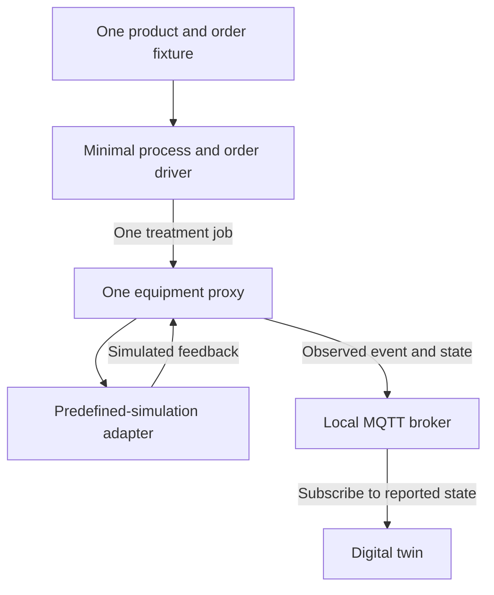

# Base system implementation proposal

Status: Proposed

## Goal

Build a small, simulated end-to-end system that demonstrates one product order moving through one equipment service and appearing in the digital twin. Use this slice to learn the concrete state and interface shapes before expanding to multiple machines, physical equipment, or recovery infrastructure.

This proposal sequences implementation; it does not finalize the detailed bindings left open by [ADR 0010](../adr/0010-interface-contract-baseline.md).

## First vertical slice

Include:

- One fixed product definition and one order fixture.
- A minimal production-process/order driver that starts the order and hands its single treatment job to one equipment proxy. Keep this as small as possible; do not build general product configuration or a full MES.
- One equipment proxy and one adapter in predefined-simulation mode. The adapter returns simulated feedback through the same local proxy boundary intended for physical feedback, and marks it as simulated.
- One local MQTT broker. The proxy publishes observed events and state using the candidate envelope and topic pattern in ADR 0010, binding only the fields needed by this slice.
- A digital twin that subscribes to the broker and renders proxy-reported state and feedback provenance. It renders confirmed feedback, not a command or optimistic UI state.

The order driver-to-proxy handoff is an explicit temporary seam: agree a minimal contract for the slice, keep it local to the participating components, and document it as provisional rather than implying ADR 0010 has selected its production transport.

## Delivery sequence

1. **Agree the slice boundary.** Choose one stable demo equipment identity, one treatment service, a minimal order/job shape, and the subset of the candidate MQTT envelope needed to show the flow. Record provisional bindings in the participating component repositories; leave unrelated payload fields and broker policies open.
2. **Implement one complete simulated order.** Start the fixture order, pass the job to the proxy, let the predefined adapter produce simulated feedback, publish the resulting proxy state, and render it in the twin. Preserve the `predefinedSimulation` provenance throughout.
3. **Exercise observable behavior.** Demonstrate start, completion and an error result. Verify that a command alone does not appear as completed state, the twin updates from reported feedback, and duplicate or delayed MQTT delivery does not falsely complete an order.
4. **Expand only after the slice works.** Add a second proxy and the fail-closed negotiation of ADRs 0002 and 0004; then consider transport services, operator-driven simulation controls, the MES read path, and physical adapters after equipment inspection and interface verification.
5. **Revisit timing and recovery with evidence.** Configure timing budgets for the tested deployment under ADR 0003. Define the actual state and order lifecycle from the running slice before deciding checkpoint contents, schema evolution, or coordinated restart behavior.

## Explicit non-goals for the first slice

- Physical machine control, sensor mapping, or assumptions about legacy controller signals.
- Multi-machine selection, negotiation, transport movement, or a full MES.
- Production-grade availability, host redundancy, order recovery, or promises about restart behavior.
- Choosing a checkpoint database or adding persistence that has not been justified by the observed state model.

## Decision needed before implementation

[ADR 0011](../adr/0011-persistent-proxy-state.md) currently requires durable checkpoints of confirmed proxy state. This proposal recommends revisiting that requirement before implementation: keep the safety invariant that commands are not confirmed state, but defer checkpoint design and restart recovery until the vertical slice establishes which state is owned by the proxy and how it relates to an order. Do not silently treat this proposal as superseding ADR 0011; record any change through an ADR.

## Completion criteria

The first slice is demonstrated when one fixture order reaches a simulated completion through the proxy and adapter, the proxy publishes the resulting feedback to the local broker, and the digital twin displays it with simulation provenance. The implementation documents provisional contracts and leaves physical behavior and restart recovery explicitly unclaimed.
