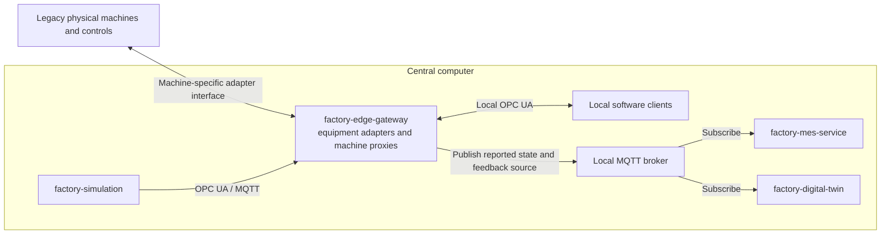
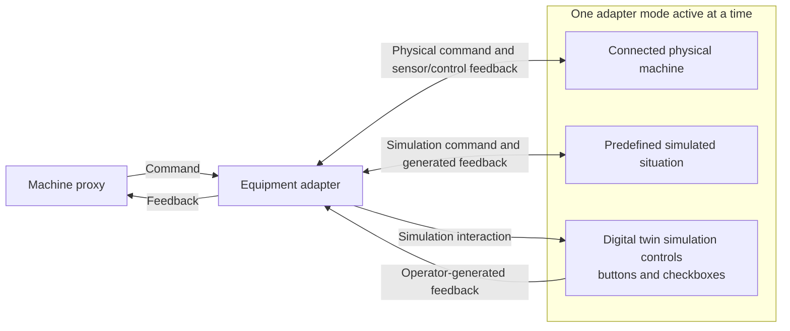
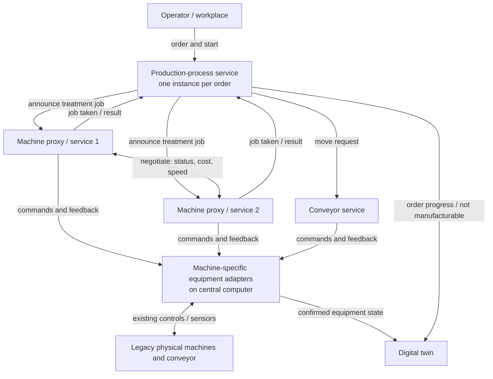

# Architecture overview



All components and protocol endpoints run on the central computer. OPC UA and MQTT are local software interfaces; they are not assumed to be available on the physical machines. The proxies and legacy-equipment boundary are described in [ADR 0007](../adr/0007-local-machine-proxies-and-legacy-adapters.md). Detailed interface contracts remain to be specified.

### Equipment adapter operational modes

Each adapter operates either with its physical machine connected or in disconnected simulation mode. In simulation mode, it uses one feedback source: a predefined simulated situation or operator-generated feedback from the digital twin. In every mode, commands and feedback pass through the adapter to the machine proxy. Simulated feedback is not physical sensor confirmation (see [ADR 0008](../adr/0008-adapter-operational-modes.md)).



## Logical architecture: decentralized machine selection

See [ADR 0002](../adr/0002-decentralized-machine-selection.md). Machine services negotiate who takes a treatment job; the production-process service only learns the outcome.

### Components



### Sequence for one treatment step

```mermaid
sequenceDiagram
    actor Operator
    participant Process as Production-process service
    participant M1 as Machine proxy 1
    participant M2 as Machine proxy 2
    participant Adapter as Machine-specific equipment adapter
    participant Equipment as Legacy machine / conveyor
    participant Twin as Digital twin

    Operator->>Process: Start order for workpiece
    Process->>M1: Announce treatment job
    Process->>M2: Announce treatment job

    loop Negotiation rounds until a machine commits or the deadline expires
        M1->>M2: Propose: own status, cost, speed
        M2->>M1: Propose: own status, cost, speed
        Note over M1,M2: Each service requires the complete offer set and confirms the same winner; only the winner commits after all participants confirm (ADR 0004)
    end

    alt A machine takes the job, here M2
        M2-->>Process: Job taken by M2
        Process-->>Twin: Update order progress
        M2->>Adapter: Command treatment
        Adapter->>Equipment: Send command
        Equipment-->>Adapter: Status and completion feedback
        Adapter-->>M2: Confirmed machine state
        Adapter-->>Twin: Confirmed machine state
        M2-->>Process: Treatment complete
        Process->>Adapter: Request carrier movement
        Adapter->>Equipment: Command conveyor
        Equipment-->>Adapter: Carrier-position feedback
        Adapter-->>Twin: Confirmed carrier position
        Adapter-->>Process: Movement confirmed
    else No machine commits before the deadline
        Note over Process: Process service decides the deadline has expired
        Process->>M1: Withdraw job announcement
        Process->>M2: Withdraw job announcement
        Process-->>Twin: Product cannot be manufactured
        Process-->>Operator: Report: not manufacturable
    end
```

### Decision ownership

| Decision | Owner |
|---|---|
| Which machine takes the job | Machine services (negotiated) |
| Whether the machine starts and performs the treatment | The machine service that took the job |
| Whether the product cannot be manufactured | Production-process service |
