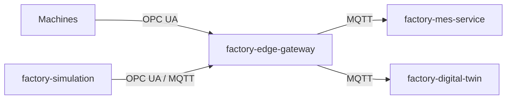
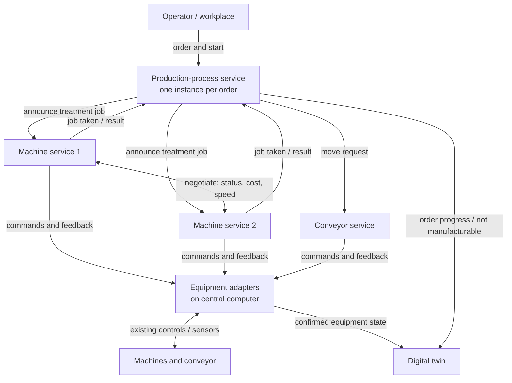
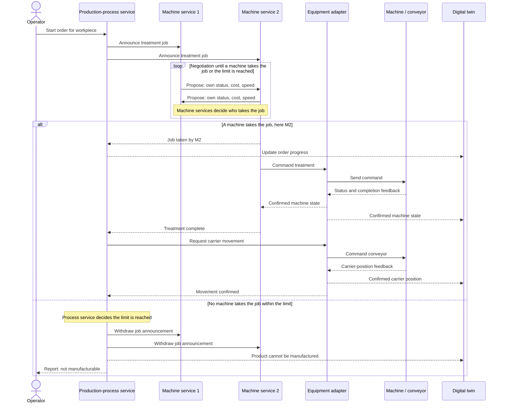

# Architecture overview

## Logical architecture: decentralized machine selection

See [ADR 0002](../adr/0002-decentralized-machine-selection.md). Machine services negotiate who takes a treatment job; the production-process service only learns the outcome.

### Components

### Sequence for one treatment step

### Decision ownership

| Decision | Owner |
|---|---|
| Which machine takes the job | Machine services (negotiated) |
| Whether the machine starts and performs the treatment | The machine service that took the job |
| Whether the product cannot be manufactured | Production-process service |
